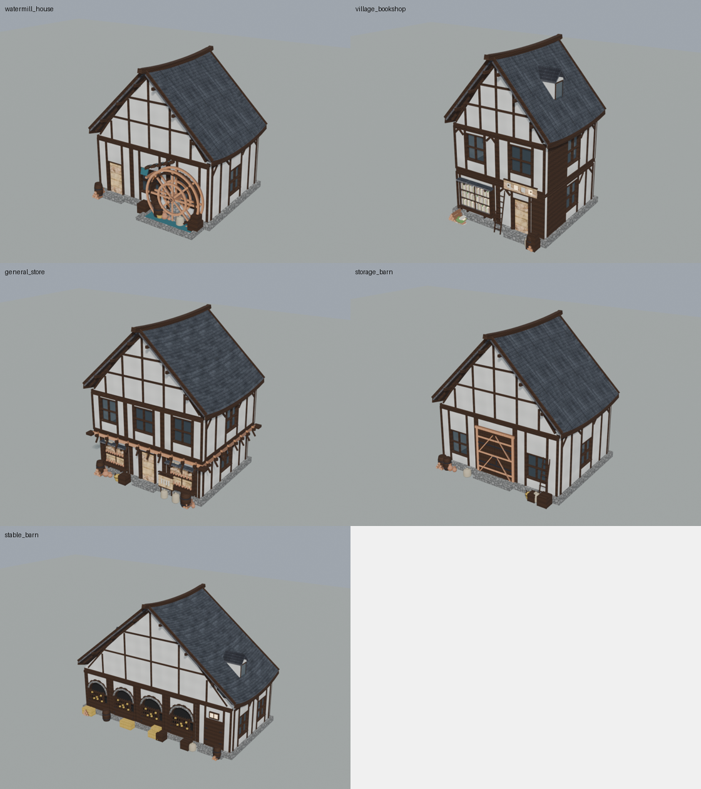
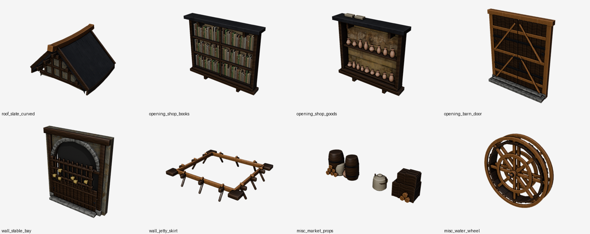

# 中世纪街市建筑模块（水磨坊 / 书店 / 杂货铺 / 谷仓 / 马厩）

本文记录这一批「中世纪街市」构件的实现方式，覆盖参考图里的五栋建筑：
带大水轮的水磨坊、整面书架的乡村书店、挑楼式杂货铺、双开仓门谷仓、圆拱开间马厩。

所有实现都落在既有工程结构里，没有新增目录层级：

```
generator/geom/*.py        新增构件几何（纯 Python，仅依赖 MeshBuilder）
generator/schema.py        Medieval 开关新增 9 个字段
generator/assemble.py      装配阶段接线（立面特化 / 屋顶分支 / 沿墙陈设）
generator/material/pbr.py  新增街市材质槽（麻布 / 陶 / 纸 / 铁 / 水 / 暖光 / 橱窗玻璃）
generator/preview.py       单模块预览映射（模块库里能直接看）
data/styles/*.json         5 个风格预设（含 footprint preset）
data/modules/*.json        8 个模块描述符（模块库列表页直接可见）
tools/render_style.py      风格多视角渲染（可视化自检）
tools/qa_styles.py         5 个风格批量出图
tools/test_street_modules.py  构件几何自检（纯 Python，不需要 Blender）
```

## 零、成品速览

五栋建筑（3/4 视角，`.run/qa/*/<风格>_quarter.png` 同一套渲染参数）：



模块库里新增的 8 个构件缩略图（`data/previews/*.png`，Workbench 渲染）：



## 一、新增构型开关（Spec.medieval）

| 字段 | 类型 | 作用 |
| --- | --- | --- |
| `slate_roof` | bool | 改用板岩弯坡屋顶（厚石瓦 + 翘檐 + 通长脊梁 + 露明椽条） |
| `roof_curve` | float 0~1 | 翘檐幅度，0 为平直坡面 |
| `water_wheel` | bool | 正面挂水轮，并生成轮坑水面、石岸与送水木槽 |
| `shopfront` | bool | 指定开间的首层换成橱窗/敞口货架（内容由样式 `shop_kind` 决定） |
| `shop_board` | bool | 门楣横招牌；样式里 `standing_sign` 为真时再加一块落地立牌 |
| `barn_door` | bool | 门所在开间换成通高双开仓门（拼板 + Z 斜撑 + 铁箍 + 石门槛） |
| `stable_bays` | bool | 首层正面除门开间外全部改成圆拱马厩开间 |
| `jetty_brackets` | bool | 悬挑层下方补托木、斜撑、搁栅端头与封边梁 |
| `street_props` | bool | 沿墙堆放木桶、木箱、麻袋、草垛、书堆、陶罐、藤篮与柴堆 |
| `ladder` | bool | 靠墙木梯 |

对应 `backend/app/schemas.py::MedievalSpec` 与 `frontend/src/api/client.ts::Medieval`
已同步，前端无需改逻辑，按 `/api/styles` 拉到新样式即可生成。

## 二、新增几何模块

| 文件 | 主要函数 | 说明 |
| --- | --- | --- |
| `geom/slate_roof.py` | `build_slate_roof` | 板岩弯坡顶：屋面基层（带厚度、封闭）+ 错缝石板瓦 + 脊梁（端头起翘）+ 三道檩条 + 椽条 + 封檐板 + 博风板 + 山墙三角面与半木构 |
| `geom/watermill.py` | `build_water_wheel` / `build_mill_pit` | 水轮（双轮缘、辐条、叶片、轮毂、带铁箍轮轴）与轮坑（石岸、水面、水槽、水帘、轴墩） |
| `geom/shopfront.py` | `build_shop_window` | 橱窗：木框 + 三层书架（或两层陶罐货架）+ 暖光内衬 + 六格玻璃 + 窗台与挑檐 |
| `geom/stable.py` | `build_stable_bay` / `build_tack_room_door` | 马厩开间（立柱、券石拱圈、起拱横木、挡马门、草料架、干草、洞内暗背板）与鞍具房门 |
| `geom/barn.py` | `build_barn_door` / `build_door_hood` | 双开仓门（竖拼板、横档、Z 斜撑、熟铁箍、门轴、石门槛）与可选门头披檐 |
| `geom/jetty.py` | `build_jetty_skirt` | 悬挑层托木裙带（封边梁、托木 + 斜撑、45° 角托、搁栅端头） |
| `geom/props.py` | `add_barrel` / `add_crate` / `add_sack` / `add_hay_bale` / `add_book_stack` / `add_pot` / `add_basket` / `add_log_pile` / `build_ladder` / `build_sign_board` / `build_wall_board` / `build_street_props` | 街市陈设库；旋转体用 `lathe`，斜撑与叶片用 `_box_frame`，全部封闭实体 |

约定与既有构件保持一致：

- 立面构件的局部坐标都是「X 沿墙、Y=0 为墙外饰面、-Y 朝外、Z 自墙脚起算」，
  因此装配阶段只需要给位置与绕 Z 的旋转；
- 不引入布尔运算：墙板洞口由 `wall_panel` 的矩形分解挖出，拱头用条带逼近；
- 每个构件是封闭实体或有意为之的双面片（玻璃、水面、背板），
  `create_object` 里的 `recalc_face_normals` 负责统一朝向；
- UV 仍由 `MeshBuilder.planar_uvs` 按米/`tile_m` 计算，贴图密度与整栋一致。

## 三、装配接线（assemble.py）

1. **立面特化**：`_front_bay_plan()` 按开间返回 `(洞口列表, 种类, 是否强制圆拱)`，
   种类有 `normal / shop / stable_arch / stable_door / barn_door`；
   `_front_bay_parts()` 再把对应构件挂到该开间上（局部 X 偏移对齐洞口）。
2. **偏置门开间**：样式可用 `door_bay` 把门挪到指定开间（水磨坊门在左、马厩门在末开间）。
3. **马厩**：`force_arched / force_round_arch` 让首层正立面的洞口用圆拱条带挖出，
   并关掉该开间的墙板玻璃（洞里是挡马门与草料架）。
4. **屋顶**：`slate_roof` 分支替换 `build_gable_roof`，并用
   `ridge_height()` 保持烟囱/老虎窗的定位与坡屋顶一致；
   屋脊压梁不再重复生成（`ridge_cap` 与板岩顶互斥）。
5. **挑楼**：`jetty_brackets` 在每层楼板下方按该层轮廓挂一圈托木裙带。
6. **沿墙陈设**：`street_props` 在毛石勒脚之外堆一圈杂物，按 `door` 位置自动让开门口。

## 四、风格预设

| 风格 id | 名称 | footprint | 关键开关 |
| --- | --- | --- | --- |
| `watermill_house` | 水磨坊 | 8.6 × 6.6，3 开间，1 层，层高 4.0，坡度 46° | slate_roof / water_wheel / stone_plinth / street_props，门在左开间 |
| `village_bookshop` | 乡村书店 | 6.6 × 6.2，2 开间，2 层，层高 3.05，坡度 50° | slate_roof / shopfront(books) / shop_board / street_props / ladder / 1 老虎窗 |
| `general_store` | 杂货铺 | 8.2 × 6.6，3 开间，2 层，层高 2.95，坡度 44° | jetty + jetty_brackets / shopfront(goods, 敞口) / shop_board + 立牌 / street_props |
| `storage_barn` | 谷仓仓库 | 9.4 × 7.2，3 开间，1 层，层高 4.3，坡度 46° | barn_door / slate_roof / stone_plinth / street_props / ladder |
| `stable_barn` | 马厩 | 14.0 × 6.8，5 开间，1 层，层高 3.7，坡度 40° | stable_bays / slate_roof / stone_plinth / street_props / 1 老虎窗，门在末开间 |

材质统一走 CC0 实拍集：`plaster_cream`（灰泥墙）、`timber_oak`（深色木构）、
`RoofingTiles013A`（深色板岩）、`Wood092`（水轮/脊梁/搁栅）、`Planks039`（门板）、
`stone_rubble`（毛石勒脚）、`thatch_straw`（干草）。

## 五、模块库

新增 8 个模块描述符（`data/modules/`），并在 `generator/preview.py` 里给了对应的
单模块样例几何，所以模块库列表、缩略图、GLB 预览都能直接用：

`roof_slate_curved`、`opening_shop_books`、`opening_shop_goods`、`opening_barn_door`、
`wall_stable_bay`、`wall_jetty_skirt`、`misc_market_props`、`misc_water_wheel`。

## 六、验证方式

```powershell
# 1) 构件几何自检（纯 Python，零依赖）
python tools\test_street_modules.py

# 2) 既有墙板测试回归
python tools\test_wall_panel.py

# 3) 单栋多视角渲染（QE 出图到 .run/qa/<风格>/）
D:\blender\blender.exe -b --factory-startup --python-exit-code 1 `
  --python tools\render_style.py -- --style watermill_house --out .run\qa\watermill_house --views front,quarter,side

# 4) 五个风格批量出图
python tools\qa_styles.py "front,quarter,side" 900

# 5) 走正式生成链路（与后端一致）并校验 GLB
D:\blender\blender.exe -b --factory-startup --python-exit-code 1 `
  --python generator\entry.py -- --job data\jobs\demo_watermill\in.json
python tools\validate_gltf.py data\jobs\demo_watermill\out\model.glb
```

参考结果（本机 Blender 5.2.2）：

| 风格 | 三角面 | 对象数 | 材质 |
| --- | --- | --- | --- |
| watermill_house | ≈31.7k | 30 | 12 |
| village_bookshop | ≈30.9k | 47 | 14 |
| general_store | ≈52.8k | 59 | 12 |
| storage_barn | ≈27.1k | 30 | 10 |
| stable_barn | ≈51.8k | 47 | 11 |

单栋构建 + 导出仍在 1 s 量级（渲染耗时另计）。

## 七、用 dsh-blender 插件做的额外体检

除工程内的自检外，还用 dsh-blender 的无头通道对导出结果做了两次独立检查：

```powershell
# 1) 导入 GLB → 逐对象统计三角面/非流形边/退化面 + 四视角出图（.run/qa/audit_glb.py）
#    脚本通过 blender_rt_headless 的 script_file 参数执行，产物落 .run/qa/audit_stable/
# 2) 在生成器内部（导出前）统计同一组指标（.run/qa/audit_src.py）
```

结论与注意点：

- **GLB 层面的「非流形边」不可用作判据**：glTF 会按 UV/法线拆分顶点，导入后几乎所有
  边都是边界边（实测 47 个对象共 44k 条）。要看拓扑必须审计导出前的源网格。
- **导出前源网格的退化面是工程既有的现象**，与本次新增构件无关：对既有
  `medieval_timber_pbr` 实测 19,330 个面积 < 1e-7 的面（主要来自拱券条带墙板叠加
  倒角/细分），新风格 `stable_barn` 为 2,152 个，量级更低。工程自带的
  `tools/test_wall_panel.py` 在 MeshBuilder 层（倒角/细分之前）断言零退化，这部分是
  通过状态。若要彻底消掉，需要在 `quality._bevel/_subdivide` 之后加一遍
  `bmesh.ops.dissolve_degenerate`，属于生成器层的独立改进项。
- 四视角出图（`.run/qa/audit_stable/audit_*.png`）与 .run/qa 下的风格渲染一致，
  确认 GLB 往返后材质、法线、透明水面都正常。

## 八、取舍与已知限制

- **水面是一张半透明面片**：不做流体与岸边地形，因此水轮「泡在水里」的下半截
  靠水面与暗色池底遮挡出来的视觉关系，而不是真实水体。
- **山墙三角面贴在山墙线上**：屋面挑出山墙 0.36 m，露出的椽条/檩条端头与博风板
  一起读成出檐；没有做封闭檐底（soffit）。
- **马厩开间内部压了暗背板**：为了让洞口读出进深，代价是这一开间不透光。
- **橱窗暖光用自发光材质**（`glow` 槽），GLB 里不带真实灯光。
- **石板瓦是逐片薄盒**：当前 8 行 × 每行 ~12 片，合计每坡约 100 片；若要更低模，
  可把 `slate_rows` 调小或把行内合并成整条。
